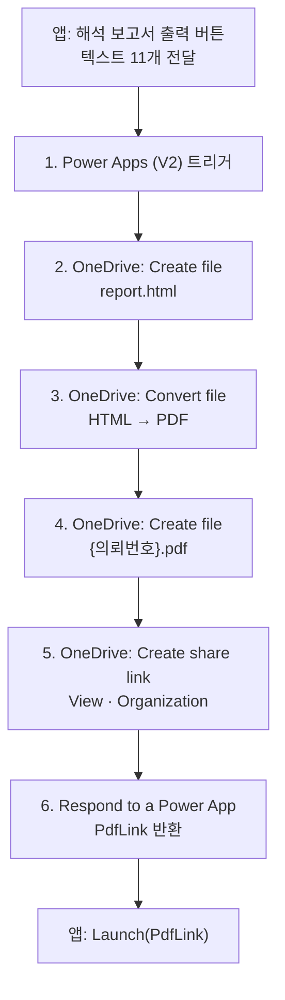

# PDF 생성 흐름 (Power Automate)

완료된 해석 의뢰를 한 장짜리 PDF 의뢰서로 출력하는 클라우드 흐름입니다.
앱 YAML에는 포함되지 않는 별도 리소스이므로 이 폴더에서 정의와 템플릿을 관리합니다.

| 파일 | 내용 |
|--|--|
| `report_template.html` | 흐름의 첫 번째 `Create file` 액션에 넣는 HTML 템플릿 |
| `README.md` | 흐름 정의, 앱 호출 코드, 주의사항 (이 문서) |

왜 앱 안에서 `Print()`를 쓰지 않았는지는 [docs/lessons-learned.md](../docs/lessons-learned.md#1-canvas-앱의-print는-긴-문서를-출력하지-못한다)에 정리되어 있습니다.

---

## 흐름 구조

흐름 이름: `해석보고서_PDF생성` (앱 수식에서 이 이름으로 호출하므로, 이름을 바꾸면 앱 쪽도 함께 바꿔야 합니다)



사용하는 커넥터는 **Power Apps**와 **OneDrive for Business** 두 가지이며 모두 표준(무료) 커넥터입니다.

### 1. 트리거 — When Power Apps calls a flow (V2)

텍스트 입력 11개를 아래 순서로 추가합니다. 앱에서는 이름이 아닌 **순서**로 값을 넘기므로 순서가 바뀌면 안 됩니다.

| 순서 | 흐름 내부 키 | 입력 이름 | 비고 |
|--|--|--|--|
| 1 | `text` | RequestNo | 의뢰번호 |
| 2 | `text_1` | RequesterName | 요청자 |
| 3 | `text_2` | RequesterTeam | 요청자 팀 |
| 4 | `text_3` | SubmittedAtText | 요청일 (앱에서 문자열로 변환해 전달) |
| 5 | `text_4` | ExpectedFinishDateText | 희망완료일 (문자열) |
| 6 | `text_5` | ProductName | 품명 |
| 7 | `text_6` | PartNo | 품번 |
| 8 | `text_7` | AnalysisReason | 해석사유 |
| 9 | `text_8` | AnalysisCondition | 해석 조건 및 검토사항 |
| 10 | `text_9` | ApproverName | 팀장 승인자 이름 |
| 11 | `text_10` | ApprovedDateText | 팀장 승인일 (문자열) |

날짜는 흐름에서 포맷을 바꾸지 않고, 앱에서 `Text(날짜, "yyyy년 mm월 dd일")`로 변환한 문자열을 그대로 받습니다.

### 2. Create file — HTML 생성

| 필드 | 값 |
|--|--|
| Folder Path | `/해석보고서_임시` (원하는 OneDrive 폴더) |
| File Name | `report.html` |
| File Content | `report_template.html` 전체 |

템플릿의 `@{triggerBody()?['text_N']}` 부분이 트리거 입력값으로 치환됩니다. 디자이너 화면에서는 보라색 동적 콘텐츠 칩으로 보이며, **Code view**에 템플릿을 통째로 붙여 넣으면 칩 연결이 그대로 유지됩니다.

### 3. Convert file — PDF 변환

| 필드 | 값 |
|--|--|
| File | 2번 액션의 **Id** (Path 아님) |
| Target type | PDF |

### 4. Create file — PDF 저장

| 필드 | 값 |
|--|--|
| Folder Path | `/해석보고서_임시` |
| File Name | `@{triggerBody()?['text']}.pdf` |
| File Content | 3번 액션의 File content |

### 5. Create share link

| 필드 | 값 |
|--|--|
| File | 4번 액션의 **Id** (Path 아님) |
| Link type | View |
| Link scope | Organization |

### 6. Respond to a Power App or flow

텍스트 출력 `PdfLink` 하나를 추가하고, 값으로 5번 액션의 **Web URL**을 넣습니다.

---

## 앱에서 호출하는 코드

적용 위치: `WorkRequest_Screen` › `btnPrintReport` › `OnSelect`

```powerfx
// 결재란에 넣을 팀장 승인 기록 조회
Set(
    varApproveLog,
    LookUp(
        Analysis_Request_Log_DB,
        RequestIDKey = varSelectedRequest.RequestIDKey &&
        LogType.Value = "TeamLeaderApprove"
    )
);

// 흐름 호출: 인자 순서는 트리거 입력 순서와 같아야 함
Set(
    varPdfResult,
    '해석보고서_PDF생성'.Run(
        varSelectedRequest.RequestNo,
        varSelectedRequest.RequesterName,
        varSelectedRequest.RequesterTeam,
        Text(varSelectedRequest.SubmittedAt, "yyyy년 mm월 dd일"),
        If(
            IsBlank(varSelectedRequest.ExpectedFinishDate),
            "-",
            Text(varSelectedRequest.ExpectedFinishDate, "yyyy년 mm월 dd일")
        ),
        varSelectedRequest.ProductName,
        varSelectedRequest.PartNo,
        varSelectedRequest.AnalysisReason,
        varSelectedRequest.AnalysisCondition,
        Coalesce(varApproveLog.ActionByName, "-"),
        If(
            IsBlank(varApproveLog.ActionAt),
            "-",
            Text(varApproveLog.ActionAt, "yyyy년 mm월 dd일")
        )
    )
);

// 반환된 공유 링크 열기 (반환 필드명은 소문자 pdflink)
Launch(varPdfResult.pdflink)
```

---

## 템플릿 스타일 기준

A4 한 장에 들어가도록 여백과 글자 크기를 줄여 둔 값입니다. 내용이 길어 두 장으로 넘어가면 아래 값을 더 줄이면 됩니다.

| 항목 | 값 |
|--|--|
| 본문 여백 | 24px 32px |
| 기본 글자 크기 | 10px |
| 제목 | 18px |
| 의뢰번호 | 14px |
| 라벨 열 너비 | 70px |
| 값 셀 글자 크기 | 11px |
| 표 셀 여백 | 6px 8px |
| 본문 줄 간격 | 1.4 |
| 구역 사이 간격 | 16px |
| 결재란 너비 | 300px |

색상은 강조선 `#1b263b`, 라벨 배경 `#f8fafc`, 테두리 `#cbd5e1` / `#e2e8f0`, 본문 `#0f172a`입니다.
템플릿 상단과 하단의 기관명 문구(`CENTRAL R&D CENTER`, `기술연구소`)는 사용하는 조직 이름으로 바꾸면 됩니다.

---

## 주의사항

- **File 파라미터에는 Id를 넣습니다.** `Convert file`과 `Create share link`에 경로 문자열(Path)을 넣으면 "파일 ID가 유효하지 않습니다"(400) 오류가 납니다.
- **공유 범위는 Organization입니다.** 많은 조직이 익명(Anonymous) 링크를 정책으로 막아 두며, 이 경우 "링크를 통한 공유를 사용하지 않도록 설정했습니다" 오류가 납니다.
- **흐름은 솔루션 안에 있어야 합니다.** Teams에서 여는 Power Apps Studio는 솔루션에 포함된 흐름만 목록에 보여 줍니다. 내 흐름(My flows)에서 만들었다면 솔루션을 만들고 "기존 항목 추가"로 넣습니다.
- **앱과 흐름은 같은 환경에 있어야 합니다.** 환경 표시 이름이 같아 보여도 다른 환경일 수 있으니 URL의 환경 ID로 확인합니다.
- **PDF는 OneDrive에 남습니다.** `report.html`은 매번 덮어쓰고 PDF는 의뢰번호별로 하나씩 남습니다. 어느 계정의 OneDrive에 저장되는지는 흐름의 "실행 전용 사용자" 연결 설정에 따라 달라지므로(버튼을 누른 사용자의 연결 또는 소유자의 연결), 배포 전에 확인하고 주기적으로 정리합니다.
- **소유자를 한 명만 두지 않습니다.** 흐름 소유자 계정이 비활성화되면 출력이 멈출 수 있으므로 공동 소유자를 지정해 둡니다.
